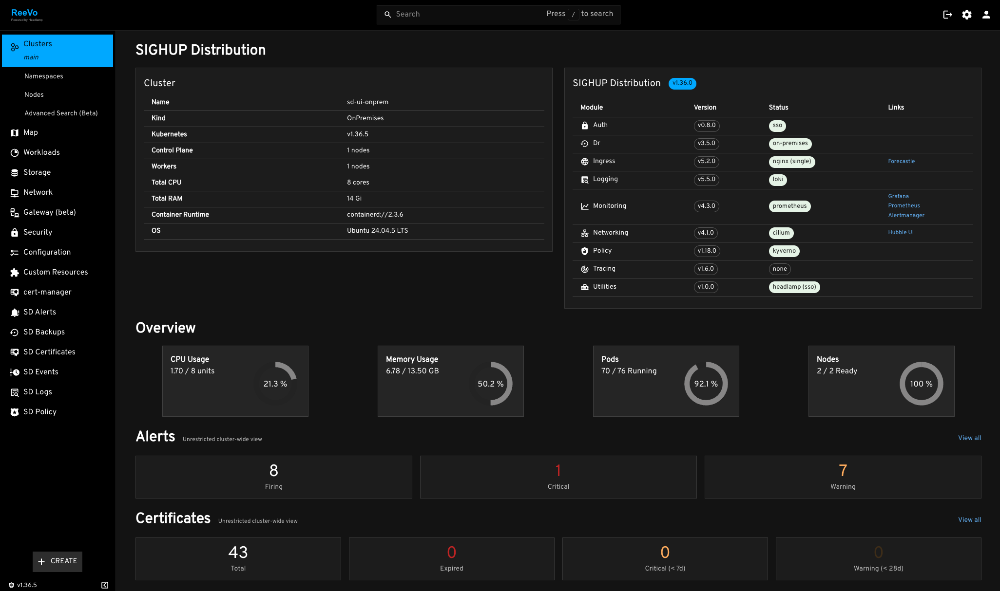

<!-- markdownlint-disable MD033 -->
<h1 align="center">
<picture>
  <source media="(prefers-color-scheme: dark)" srcset="https://raw.githubusercontent.com/sighupio/distribution/refs/heads/main/docs/assets/white-logo.png">
  <source media="(prefers-color-scheme: light)" srcset="https://raw.githubusercontent.com/sighupio/distribution/refs/heads/main/docs/assets/black-logo.png">
  
</picture><br/>
  SIGHUP Distribution UI
</h1>
<!-- markdownlint-enable MD033 -->


**SIGHUP Distribution UI** is the web interface of [SIGHUP Distribution (SD)][sd-repo]. In one place it shows the state of the cluster and of the SD modules: the cluster overview, the Prometheus alerts, the certificate expiry, the events and the logs, the Velero backups and the policy violations. Built on [Headlamp][headlamp-repo], it is ready for multi-tenant clusters: behind [Capsule Proxy][capsule], every user sees only the namespaces of their tenant.

If you are new to SD please refer to the [official documentation][sd-docs] on how to get started with SD.

## Overview



- **Cluster overview**: a landing page that replaces the default Headlamp overview, with the distribution version, the status of each module and its type (e.g. "opensearch (triple)"), links to the infrastructure UIs (Grafana, Prometheus, OpenSearch Dashboards, Hubble...), resource usage charts, and summary cards for alerts, certificates, backups and policy violations.
- **Monitoring**: firing Prometheus alerts grouped by rule group, with labels, graph queries and runbook links; X.509 certificate expiry tracking (expired, critical < 7d, warning < 28d).
- **Events and logs**: historical Kubernetes events and logs from Loki or OpenSearch, and "View Logs" links on the workload detail pages to Grafana Explore or OpenSearch Dashboards.
- **Backups**: Velero backups, restores and schedules, with error details and volume snapshot stats.
- **Policy**: violations from Kyverno (PolicyReports) or Gatekeeper (constraint status).
- **Multi-tenancy**: tenant-scoped pages (events, policy) show only the namespaces the user can access, and pages with cluster-wide data (alerts, certificates, backups) are marked with an "Unrestricted cluster-wide view" indicator. A user without namespaces sees empty results, never cluster-wide data.
- **SSO**: the logout goes through Pomerium, so the user lands back on the login page.

## Plugins

Each feature is a Headlamp plugin:

| Plugin                         | Description                                                                                                         |
| ------------------------------ | ------------------------------------------------------------------------------------------------------------------- |
| [sd-core][sd-core]             | Cluster landing page with distribution info, module status, service links, charts and summary cards. Pomerium logout. |
| [sd-alerts][sd-alerts]         | Firing Prometheus alerts grouped by rule group, with severity counters, details and links to Prometheus.           |
| [sd-certificates][sd-certs]    | X.509 certificate expiry monitoring through the Prometheus `x509_cert_not_after` metric.                            |
| [sd-events][sd-events]         | Historical Kubernetes events from Loki or OpenSearch, with time range and namespace filters.                        |
| [sd-logs][sd-logs]             | Log viewer with Loki and OpenSearch backends.                                                                       |
| [sd-backups][sd-backups]       | Velero backup, restore and schedule dashboard.                                                                      |
| [sd-policy][sd-policy]         | Policy violations from Kyverno or Gatekeeper, with namespace filtering.                                             |
| [sd-loki-links][sd-loki-links] | "View Logs" links on Pod, Deployment, DaemonSet, StatefulSet and Namespace detail pages.                            |
| [sd-prometheus-autoconfig][sd-prom] | Configures the Prometheus address of the Headlamp Prometheus plugin. No UI.                                    |
| [headlamp-reevo-theme][theme]  | Dark theme and logo.                                                                                                |
| [cert-manager][cert-manager]   | Upstream Headlamp plugin for the cert-manager resources, downloaded at build time.                                  |

## Compatibility

| SD UI    | Headlamp  | Utilities Module | SIGHUP Distribution |
| -------- | --------- | ---------------- | ------------------- |
| `v0.1.1` | `v0.40.1` | `v0.1.1`         | `v1.36.0`           |

The plugins adapt to the flavor of each SD module (e.g. Loki or OpenSearch, Kyverno or Gatekeeper): see the [flavor compatibility matrix](docs/SD_COMPATIBILITY.md).

## Usage

The image is published as `registry.sighup.io/fury/sd-ui`, and as `registry.sighup.io/fury-secured/sd-ui` after CVE scanning and patching.

The manifests that deploy it are part of the [Utilities Module][utilities-repo]: [`furyctl`][furyctl-repo] deploys it when you create or update an OnPremises or Immutable cluster with `spec.distribution.modules.utilities.headlamp` enabled in your `furyctl.yaml`. See the module documentation for the [configuration][utilities-config], and its [examples][utilities-examples] to deploy the UI with `kustomize` on other clusters.

To install SD from scratch, follow the [Getting started][getting-started] guide.

## Development

The development environment is a Kind cluster with the whole SD stack (SSO, Capsule, monitoring, logging...) and Tilt to reload the plugins on every change:

```bash
mise install
echo '<your machine IP>' > host-ip.txt
mise run up    # Kind cluster + SIGHUP Distribution + showcase apps
mise run dev   # Tilt: Headlamp with hot-reload of the plugins
```

See the [Development Guide](docs/DEVELOPMENT.md) for the details.

## Documentation

| Document                                                     | Description                                                                         |
| ------------------------------------------------------------ | ----------------------------------------------------------------------------------- |
| [Development Guide](docs/DEVELOPMENT.md)                     | Kind environment: setup, commands, architecture, auth flows, troubleshooting.       |
| [Plugin Development Guide](docs/HOW_TO_DEVELOP_A_PLUGIN.md)  | How to create a new SD plugin, with patterns and workarounds.                       |
| [Flavor Compatibility](docs/SD_COMPATIBILITY.md)             | How each plugin behaves with each SD module flavor.                                 |
| [Compatibility Validation](tests/e2e/README.md)              | End-to-end validation of the plugins against a live cluster.                        |
| [Releases](docs/releases/)                                   | Release notes.                                                                      |

<!-- Links -->

[sd-repo]: https://github.com/sighupio/distribution
[sd-docs]: https://docs.sighup.io/docs/distribution/
[headlamp-repo]: https://github.com/kubernetes-sigs/headlamp
[capsule]: https://capsule.clastix.io/
[furyctl-repo]: https://github.com/sighupio/furyctl
[utilities-repo]: https://github.com/sighupio/module-utilities
[utilities-config]: https://github.com/sighupio/module-utilities#configuration
[utilities-examples]: https://github.com/sighupio/module-utilities/tree/main/examples
[getting-started]: https://docs.sighup.io/docs/getting-started/
[sd-core]: plugins/sd-core
[sd-alerts]: plugins/sd-alerts
[sd-certs]: plugins/sd-certificates
[sd-events]: plugins/sd-events
[sd-logs]: plugins/sd-logs
[sd-backups]: plugins/sd-backups
[sd-policy]: plugins/sd-policy
[sd-loki-links]: plugins/sd-loki-links
[sd-prom]: plugins/sd-prometheus-autoconfig
[theme]: plugins/headlamp-reevo-theme
[cert-manager]: https://github.com/headlamp-k8s/plugins/tree/main/cert-manager

<!-- <FOOTER> -->

## Contributing

Before contributing, please read first the [Contributing Guidelines](docs/CONTRIBUTING.md).

### Reporting Issues

In case you experience any problem with the UI, please [open a new issue](https://github.com/sighupio/sd-ui/issues/new/choose).

## License

This project is open source and it's released under the following [LICENSE](LICENSE).

<!-- </FOOTER> -->
