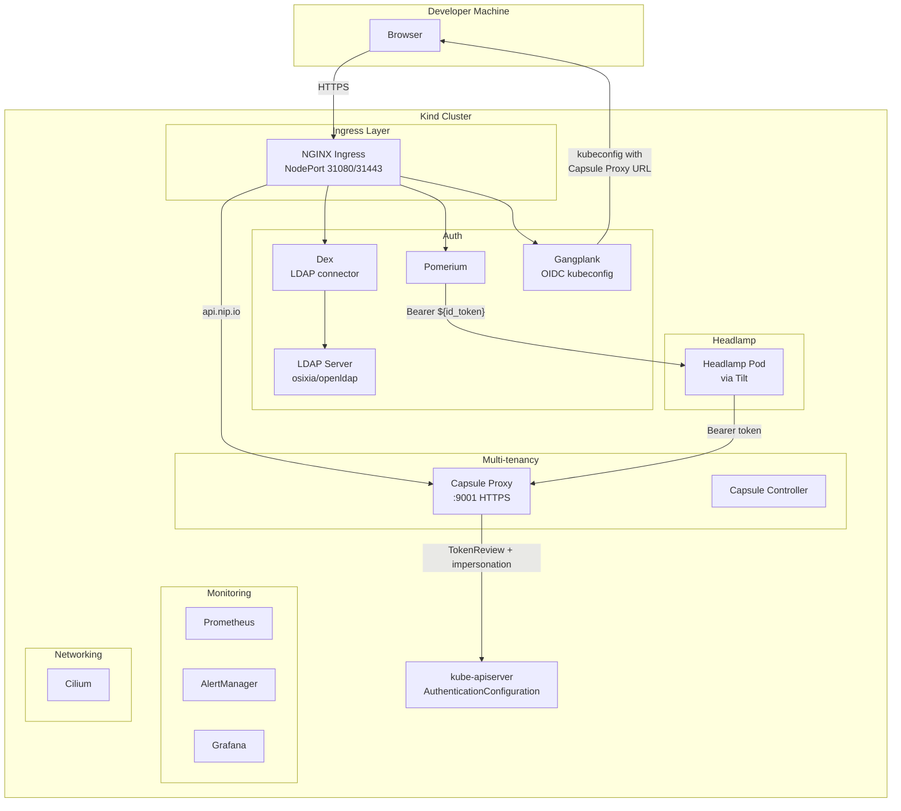
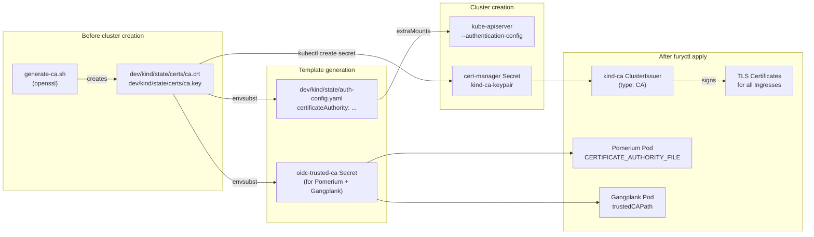
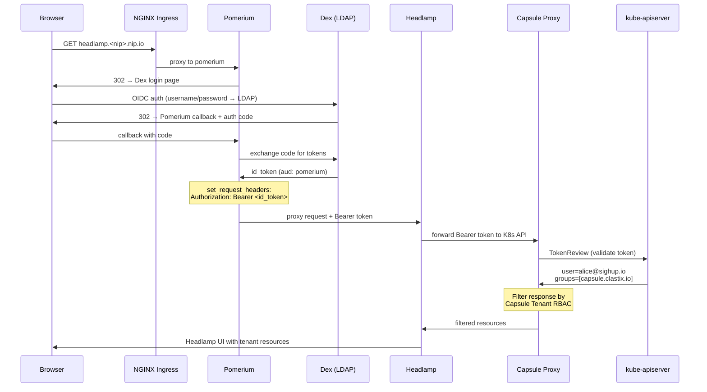
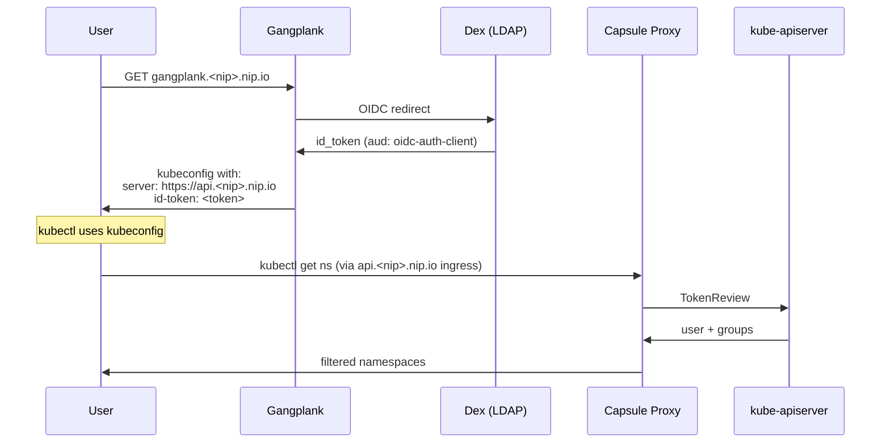

# Development Guide

## Prerequisites

- [mise](https://mise.jdx.dev/) (>= 2026.3.x) — `mise install` installs all tools
- Docker Desktop
- A network connection (for nip.io DNS resolution)
- **`host-ip.txt`** — a file in the project root containing your machine's IP address (gitignored). Create it before running any mise task:
  ```bash
  echo '192.168.1.10' > host-ip.txt   # replace with your actual IP
  ```
  If the file is missing, mise will fail with an error showing your detected IP.

## Quick Start

```bash
# Set your machine's IP (required, gitignored)
echo '192.168.1.10' > host-ip.txt

# One command to create everything (~10-15 min first time, ~5 min with cached images)
mise run up

# Build the plugins and start Tilt for Headlamp hot-reload (in a separate terminal)
mise run dev
```

Or step by step:
```bash
# 1. Start registry mirrors (once, persists across clusters)
mise run cache-up

# 2. Create Kind cluster with AuthenticationConfiguration
mise run cluster-up

# 3. Install SIGHUP Distribution + plugins
mise run furyctl-apply

# 4. Apply the headlamp/sd-spec ConfigMap the plugins read (the distribution renders it only
#    together with its own Headlamp, which on Kind comes from Tilt)
mise run sd-spec

# 5. Sync Capsule CA to Headlamp namespace
mise run sync-capsule-ca

# 6. Seed the OSD index patterns (opensearch flavor only; no-op otherwise).
#    index-patterns-cronjob fires hourly and never on creation, so without this
#    the "View logs in OpenSearch" deep links break until the next hour.
mise run opensearch-index-patterns

# 7. Start Tilt for Headlamp hot-reload (in a separate terminal)
mise run dev
```

After setup, access Headlamp at `https://headlamp.<NIP_DOMAIN>` (the actual URL is printed during setup).

LDAP test credentials: `alice`/`alice`, `bob`/`bob`, `carol`/`carol`.

### Using a development furyctl and distribution

The furyctl version is pinned in `mise.toml`. To apply with a local furyctl build and a local
distribution checkout (e.g. to test unreleased changes to both):

```bash
# Build furyctl from your checkout
cd /path/to/furyctl
go build -ldflags "-X main.version=v0.0.0-dev -X main.gitCommit=$(git rev-parse --short HEAD)" -o bin/furyctl .

# Back in this repository: make mise resolve furyctl to that binary
cd /path/to/sd-ui
export MISE_FURYCTL_VERSION=path:/path/to/furyctl/bin
export FURYCTL_DISTRO_LOCATION=/path/to/distribution
mise exec -- furyctl version   # must print v0.0.0-dev
mise run up                    # or: mise run furyctl-apply / mise run onprem:up
```

`MISE_FURYCTL_VERSION` overrides the pinned version for everything mise runs (`mise run`,
`mise exec`). A bare `furyctl` typed in the shell can still be the pinned binary, because the
shell `PATH` was computed before the variable was set: use `mise exec -- furyctl ...`.
`unset MISE_FURYCTL_VERSION` goes back to the pinned version. To make it permanent for your
machine only, set `furyctl = "path:/path/to/furyctl/bin"` under `[tools]` in your
`mise.local.toml` (gitignored).

Rebuild the binary after each furyctl change: mise runs whatever is in `bin/` at that moment.

## Repository Layout

| Path | Content |
|------|---------|
| `plugins/` | The Headlamp plugins (the product). |
| `docs/` | Development guides, flavor compatibility, release notes. |
| `dev/kind/` | Default Kind environment (`mise run up`): `furyctl.yaml` and its e2e template, furyctl plugins, scripts, Tilt overlays, registry cache. Generated files go to `dev/kind/state/` (gitignored). |
| `dev/onprem/` | Opt-in OnPremises environment on Lima VMs (`mise run onprem:up`), generated files in `dev/onprem/state/`. |
| `dev/lib/` | Scripts shared by both environments. |
| `dev/sample-apps/` | Showcase workloads. |
| `tests/e2e/` | Compatibility validation against a live cluster (`mise run test:*`). |
| `tests/onprem/` | Offline render test of the OnPremises config (`mise run onprem:test-render`). |

Everything under `dev/` is development tooling with dev-only credentials: no secret is committed, they are generated per machine into the `state/` directories.

### Docker Registry Mirrors

Persistent Docker registry proxies cache images from upstream registries (docker.io, ghcr.io, registry.k8s.io, registry.sighup.io, quay.io). These survive cluster rebuilds and reduce image pull times from minutes to seconds. Managed via `mise run cache-up` / `mise run cache-down`.

## Showcase Workloads

Showcase workloads are deployed automatically as part of `mise run up`. They can also be managed independently:

```bash
mise run demo-apps       # deploy (or redeploy)
mise run demo-apps-down  # remove all demo namespaces
```

The deploy performs an automated OIDC login via Dex (no browser needed), creates three Capsule tenant namespaces, and deploys:

| Namespace | Application | Description |
|-----------|------------|-------------|
| `shop` | [Google Online Boutique](https://github.com/GoogleCloudPlatform/microservices-demo) | 10-microservice e-commerce app |
| `sock-shop` | [Weaveworks Sock Shop](https://github.com/microservices-demo/microservices-demo) | Microservices retail demo with databases |
| `chaos-test` | Custom chaos workloads | Log generator, periodic crasher, bad-image (ImagePullBackOff) |

Each namespace also gets a **pod-killer** Deployment that randomly deletes a running pod every 1-5 minutes, generating events and testing self-healing.

```bash
# Check pods as the Capsule user
kubectl --kubeconfig=dev/kind/state/capsule-user/kubeconfig get pods -A

# Access the apps
# http://shop.127.0.0.1.nip.io       (Online Boutique)
# http://sock-shop.127.0.0.1.nip.io  (Sock Shop)

# Tear down
mise run demo-apps-down
```

## Commands Reference

### Environment lifecycle

| Command | Description |
|---------|------------|
| `mise run up` | Create Kind cluster, install distribution, sync CA, deploy showcase apps. Full setup. |
| `mise run dev` | Build all plugins (`plugins-build`), then start Tilt for Headlamp hot-reload (run in separate terminal). |
| `mise run down` | Tear down cluster. Keeps registry cache for faster rebuilds. |
| `mise run clean` | Remove `dev/kind/state/` and the furyctl cache: forces a full regeneration on the next `up`. |
| `mise run nuke` | Destroy everything and wipe state (CA + furyctl cache). Use after IP changes. |

### Plugin development

| Command | Description |
|---------|------------|
| `mise run plugins-install` | `npm install` for all SD plugins. |
| `mise run plugins-build` | Install deps + type-check + lint + build all plugins. |
| `mise run plugins-tsc` | Type-check only. |
| `mise run plugins-lint` | Lint only. |
| `mise run plugins-check-shared` | Check that the files shared by every SD plugin are identical. |

### Demo & testing

| Command | Description |
|---------|------------|
| `mise run demo-apps` | OIDC login + deploy sample apps in Capsule tenant. |
| `mise run demo-apps-down` | Remove all demo app namespaces. |
| `mise run test:*` | Compatibility validation against the live cluster: see [tests/e2e/README.md](../tests/e2e/README.md). |
| `mise run opensearch-index-patterns` | Run `index-patterns-cronjob` now so OSD Discover deep links work. Included in `up`; no-op unless `logging.type` is `opensearch`. |

### Desktop app

| Command | Description |
|---------|------------|
| `mise run desktop-build` | Build Headlamp Electron app for macOS with SD plugins. |

### Low-level (usually not needed directly)

| Command | Description |
|---------|------------|
| `mise run cluster-up` | Create Kind cluster with OIDC auth config. |
| `mise run cluster-down` | Delete Kind cluster. |
| `mise run cache-up` | Start Docker registry mirror proxies. |
| `mise run cache-down` | Stop registry mirrors. |
| `mise run furyctl-apply` | Apply SIGHUP Distribution via furyctl. |
| `mise run furyctl-apply-dry` | Run `furyctl apply` in dry-run mode. |
| `mise run sd-spec` | Apply the `headlamp/sd-spec` ConfigMap the plugins read, rendered from `dev/kind/furyctl.yaml`. |
| `mise run sync-capsule-ca` | Copy Capsule Proxy CA to Headlamp namespace. |
| `mise run generate-ca` | Generate self-signed dev CA. |
| `mise run generate-secrets` | Generate the Pomerium and gangplank secrets. |
| `mise run generate-templates` | Generate CA and secrets if missing, render config templates with current NIP_DOMAIN. |
| `mise run lint-scripts` | Shellcheck every script under `dev/` and `tests/`. |

## Desktop App

Builds a macOS Electron app with all SD plugins bundled. Requires Go and Node.js (both managed by mise).

```bash
mise run desktop-build
```

Output: `.build/headlamp-desktop/app/dist/Headlamp-*.dmg`

First run clones Headlamp v0.40.1 and installs dependencies (~15 min). Subsequent runs ~5 min.

> The app is unsigned. On first launch: `xattr -dr com.apple.quarantine /Applications/Headlamp.app`

## Architecture



## CA and TLS

We use a **pre-generated CA** (not the Kind cluster CA) to break the chicken-and-egg problem with AuthenticationConfiguration.



**Key point**: The same CA signs the ingress TLS certificates AND is trusted by the kube-apiserver for OIDC token validation. This means the kube-apiserver trusts Dex's TLS certificate because it's signed by the same CA in the AuthenticationConfiguration.

## AuthenticationConfiguration

K8s 1.34 supports `AuthenticationConfiguration` (GA) for structured OIDC authentication. We use it instead of `--oidc-*` flags to support **multiple audiences**:

```yaml
# dev/kind/state/auth-config.yaml (generated from .tpl)
apiVersion: apiserver.config.k8s.io/v1
kind: AuthenticationConfiguration
jwt:
- issuer:
    url: https://login.<NIP_DOMAIN>
    audiences:
    - pomerium        # for Headlamp (Pomerium passes id_token)
    - oidc-auth-client  # for CLI (Gangplank kubeconfig)
    audienceMatchPolicy: MatchAny
    certificateAuthority: |
      <dev CA PEM>
  claimMappings:
    username:
      claim: email      # alice@sighup.io
      prefix: ""
    groups:
      claim: groups     # [capsule.clastix.io]
      prefix: ""
```

The file is mounted into the Kind control-plane container via `extraMounts` in the kind-config and referenced by `--authentication-config` in the kube-apiserver.

## Auth Flow: Headlamp (via Pomerium)



> ### How to read this diagram (the critical part)
>
> The whole chain is built on **one** credential: the OIDC `id_token` that Dex issues when the user logs in. It is **passed through unchanged** from Pomerium all the way to the kube-apiserver. Nothing in the chain swaps the user out for a service account, and **no `Impersonate-User` / `Impersonate-Group` headers are used** — this is token pass-through, not impersonation.
>
> 1. **Pomerium injects the token.** After Dex authenticates the user, the Pomerium route (`dev/kind/furyctl.yaml`) sets `Authorization: Bearer ${pomerium.id_token}` on every request it proxies to Headlamp. This `id_token` has `aud: pomerium`.
> 2. **Headlamp forwards it untouched.** Headlamp runs in proxy mode (`-in-cluster`, `KUBERNETES_SERVICE_HOST=capsule-proxy.capsule-system.svc:9001`). It forwards the incoming `Authorization` header to Capsule Proxy rather than substituting its own ServiceAccount token.
> 3. **kube-apiserver validates the token.** Capsule Proxy relays the request to the kube-apiserver, which validates the token against the `AuthenticationConfiguration` (see below). The apiserver trusts Dex as an OIDC issuer (same dev CA) and accepts `aud: pomerium`. The `email` claim becomes the K8s **username**; the `groups` claim (`capsule.clastix.io`) becomes the K8s **group**.
> 4. **Capsule Proxy enforces tenant isolation.** Because the user is in the `capsule.clastix.io` group, Capsule scopes `list`/`watch` to the namespaces of the user's Tenant. The cluster-wide reads SD plugins need (Prometheus/Loki proxy, ingress `get`) are granted explicitly by the `capsule-rbac` ClusterRoles — see [RBAC and Capsule Compatibility](#rbac-and-capsule-compatibility).
>
> **What the volume mounts are for.** The Headlamp pod mounts a projected ServiceAccount token *and* a `ca.crt` (`headlamp-ca-bundle` secret, populated by `mise run sync-capsule-ca`). The `ca.crt` is **only** there so Headlamp trusts Capsule Proxy's TLS certificate on `:9001` — identity still comes from the forwarded user `id_token`, not the ServiceAccount token.
>
> **A note on impersonation (historical).** An earlier design, modelled on an internal demo deployment, used Pomerium impersonation headers + a `pomerium-impersonator` ClusterRole. That ClusterRole still ships in `dev/kind/plugins/kustomize/capsule-rbac/rbac.yaml` but is **not exercised** by the current bearer-token flow.

## Auth Flow: CLI (via Gangplank)



## Capsule Multi-tenancy

Capsule uses **Tenants** to define per-user namespace isolation. Capsule Proxy sits in front of the K8s API and filters responses.

### ProxySettings
The tenant defines which cluster-scoped resources users can see:
```yaml
proxySettings:
- kind: IngressClasses    # List
- kind: StorageClasses    # List
- kind: Nodes             # List
```

### Allowed Classes
```yaml
ingressOptions:
  allowedClasses:
    allowed: [nginx]
storageClasses:
  allowed: [standard]
```

### Label Workaround
Capsule Proxy v0.10.0 filters StorageClasses/IngressClasses using label selector `kubernetes.io/metadata.name in (...)`. This label is automatic on Namespaces but **not** on StorageClasses or IngressClasses. We add it manually:
- StorageClass: `kubectl label` in `create-cluster.sh`
- IngressClass: `customPatch` in `furyctl.yaml`

## Template System

Many config files contain the host IP (via nip.io). Since the IP changes when the network changes, we use templates:

1. `host-ip.txt` — user-created file with the machine's IP address (gitignored)
2. `dev/kind/env.sh` — sourced by mise, reads `host-ip.txt` and exports `HOST_IP`, `NIP_DOMAIN`, `KUBECONFIG` and the `KIND_*` paths
3. `.tpl` files — contain `${NIP_DOMAIN}`, `${CA_PEM_INDENTED}`, etc.
4. `generate-templates.sh` — generates the CA and the secrets if missing, then runs `envsubst` on the `.tpl` files → actual config files
5. Generated files are gitignored

**Template files** (genuinely dynamic, need envsubst): `dev/kind/kind-config.yaml.tpl`, `dev/kind/auth-config.yaml.tpl`, `dev/kind/plugins/kustomize/{gangplank,capsule-proxy-ingress,ldap-server}/*.tpl`, `dev/kind/tilt/*/*.tpl`

**Generated state** (`dev/kind/state/`, gitignored, deleted by `mise run clean`):

| Path | Written by | Content |
|---|---|---|
| `certs/ca.{crt,key}` | `dev/lib/generate-ca.sh` | Dev CA (key mode 600) |
| `secrets/pomerium/*.txt` | `generate-secrets.sh` | Pomerium cookie/shared secrets, IdP client secret, signing key |
| `secrets/gangplank/*.txt` | `generate-secrets.sh` | gangplank Dex client secret and session key |
| `kind-config.yaml`, `auth-config.yaml` | `generate-templates.sh` | Rendered cluster config |
| `kubeconfig` | `create-cluster.sh` | Cluster admin kubeconfig |
| `capsule-user/` | `capsule-login.sh`, `pomerium-login.sh` | Tenant kubeconfig, Pomerium session cookie |

Secrets are generated once per machine and never rotated by a re-run (rotating one restarts the components that use it). `dev/kind/furyctl.yaml` reads them with `{file://./state/...}`. The only credentials committed in clear text are those of throwaway in-cluster demo services (MinIO root users, the demo LDAP users and bind password).

## Tilt Hot-Reload

Tilt watches `plugins/` and rebuilds the Headlamp Docker image on changes:

```
Dockerfile: FROM headlamp:v0.40.1 + COPY plugins/
    ↓
docker_build → localhost:5000/headlamp-sd:dev
    ↓
k8s_yaml(manifests/) → deploy to Kind
    ↓
Pod restarts with new plugins
```

Headlamp helm manifests are pre-generated with `helm template` and stored in `dev/kind/tilt/headlamp/manifests/`.

## SD Plugin Architecture

### RBAC and Capsule Compatibility

SD plugins need read access to infrastructure resources outside the Capsule tenant (ingresses, service proxies). This is achieved via custom RBAC rules deployed as a furyctl kustomize plugin (`dev/kind/plugins/kustomize/capsule-rbac/rbac.yaml`).

| Role/ClusterRole | Type | Scope | Resources | Purpose |
|---|---|---|---|---|
| `sd-ingress-reader` | ClusterRole | Cluster | ingresses (get only) | Read ingress hosts for service links |
| `sd-loki-proxy` | ClusterRole | Cluster | services/proxy `loki-stack`, `loki-stack:3100` | Proxy to Loki for events/logs |
| `sd-prometheus-proxy` | ClusterRole | Cluster | services/proxy `prometheus-k8s`, `prometheus-k8s:9090` | Proxy to Prometheus for metrics/alerts/certs |

**Security impact**: All permissions are **read-only**. Users can view infrastructure metrics, alerts, certificates, and events, but cannot modify any resource outside their tenant. The `services/proxy` permission allows querying Prometheus and Loki APIs through the K8s API server proxy — the user never gets direct network access to these services.

**Key constraints with Capsule Proxy**:
- Capsule Proxy blocks `list` of namespaced resources outside the tenant, but allows `get` by name. This is why we use `useGet(name, namespace)` instead of `useList()` for ingresses and the distribution info ConfigMap.
- The `headlamp/sd-spec` ConfigMap is readable through the `sd-spec-reader` Role (`get` on that ConfigMap only, bound to the `capsule.clastix.io` group), which `dev/kind/scripts/apply-sd-spec.sh` creates together with the ConfigMap (see [Custom Cluster Landing Page](#custom-cluster-landing-page)).
- `services/proxy` `resourceNames` must include the port-suffixed name (e.g., `loki-stack:3100`), because the K8s API uses this format in the proxy URL path.
- Namespaces that might not exist (e.g., `logging` when logging is disabled) cannot have `Role` resources — use `ClusterRole` instead.

### Custom Cluster Landing Page

The `sd-core` plugin overrides the default Headlamp cluster overview by registering a route for path `/`:

```typescript
registerRoute({ path: '/', sidebar: 'cluster', name: 'cluster', component: ClusterLanding });
```

The `ClusterLanding` component detects if the cluster is a SIGHUP Distribution by reading the `headlamp/sd-spec` ConfigMap (404 = not SD). The distribution renders it only together with Headlamp (utilities module, OnPremises and Immutable). The Kind environment (`kind: KFDDistribution`) gets Headlamp from Tilt, so `mise run up` renders the ConfigMap itself from `dev/kind/furyctl.yaml` with `dev/kind/scripts/apply-sd-spec.sh` (also `mise run sd-spec`). For SD clusters it shows:
1. **SIGHUP Distribution section** — cluster info (name, kind, K8s version, nodes, CPU, RAM) + module table (version, status, service links)
2. **Overview charts** — CPU, Memory, Pods, Nodes using `TileChart` + `Node.useMetrics()`
3. **Alerts summary** — stat cards (firing/critical/warning) with "View all" link to `/sd/alerts`
4. **Certificates summary** — stat cards (total/expired/critical/warning) with "View all" link to `/sd/certificates`

For non-SD clusters, it falls back to rendering the standard overview charts only.

We tried using `registerOverviewChartsProcessor` first, but it places components in a 300px-max grid alongside the default charts — not suitable for full-width sections.

### Service Links from Ingress Resources

The distribution creates ingress resources for each infrastructure service (Grafana, Prometheus, AlertManager, etc.). With SSO (Pomerium), all ingresses are in the `pomerium` namespace. Without SSO, they are in their module namespace (monitoring, logging, etc.).

Since Capsule blocks `list` of ingresses outside the tenant, we use individual `useGet` calls for each known ingress. React hooks cannot be called conditionally or in loops, so all `useGet` calls are declared statically (for both SSO and non-SSO namespaces) and the correct set is selected based on the auth config:

```typescript
// Always call both — React hooks must be unconditional
const [grafanaSso] = Ingress.useGet('grafana', 'pomerium');
const [grafanaNoSso] = Ingress.useGet('grafana', 'monitoring');
// Pick based on config
const ingress = isSso ? grafanaSso : grafanaNoSso;
const host = ingress?.jsonData?.spec?.rules?.[0]?.host;
```

### Historical Events from Loki

The distribution's logging module includes an EventTailer (eventrouter) that captures K8s events and sends them to Loki via Fluent Operator with the label `flow="events"`.

The `sd-events` plugin queries Loki via the K8s service proxy:
```
/api/v1/namespaces/logging/services/loki-stack:3100/proxy/loki/api/v1/query_range?query={flow="events"}
```

**Double JSON encoding**: Each Loki log entry has a `message` field containing a stringified JSON with the actual K8s event. Parsing requires: `JSON.parse(logLine)` → `JSON.parse(entry.message)` → `event.involvedObject`, `event.reason`, etc.

Namespace isolation is enforced client-side: the plugin fetches all events from Loki (which has no tenant awareness), then filters by namespaces visible to the user via `Namespace.useList()` (which Capsule filters automatically).

### Prometheus Metrics, Alerts, and Certificates

Three plugins use the Prometheus service proxy (`prometheus-k8s:9090`):

**sd-prometheus-autoconfig**: Auto-configures the built-in Headlamp Prometheus plugin using `ConfigStore('prometheus').update()`. The built-in plugin's auto-detect doesn't work with Capsule (requires `list` pods/services), so we set the address manually. The address format is `namespace/service:port` without `services/` (the plugin adds it internally).

**sd-alerts**: Queries `/api/v1/rules?type=alert` (not `/api/v1/alerts`) to get alerts grouped by Prometheus rule group (e.g., `etcd3`, `ingress-nginx`). The `/api/v1/alerts` endpoint returns flat alerts without group information. Alerts are filtered for `state === "firing"` and `severity in ["critical", "warning"]`.

**sd-certificates**: Queries the `x509_cert_not_after` metric for certificate expiry. Node names for file/kubeconfig certificates are resolved via `kube_pod_info{pod=~"x509-certificate-exporter-data-plane.*"}` (a second Prometheus query), since the DaemonSet pod IP doesn't directly map to a node name and the user cannot `list` pods in the monitoring namespace.

### Plugin Development Workflow with Tilt

The Tiltfile builds the image with `PLUGINS_SOURCE=local`: instead of compiling the plugins in Docker (what CI does) it packages the `dist/main.js` built on the host, so the loop stays fast. It watches `plugins/` but ignores development files (node_modules, src, eslintcache, tsconfig, package-lock) — it only triggers a rebuild when `dist/main.js` or `package.json` changes:

```python
docker_build(
  ref=registry_url,
  only=['plugins/'],
  build_args={'PLUGINS_SOURCE': 'local'},
  ignore=['plugins/*/node_modules', 'plugins/*/src', ...],
)
```

Development cycle:
1. Edit plugin source in `plugins/<name>/src/`
2. Run `npm run build` in the plugin directory (creates/updates `dist/main.js`)
3. Tilt detects the change, rebuilds the Docker image, pushes to local registry
4. Pod restarts with the new plugin

## Troubleshooting

### Tilt push to localhost:5000 hangs (macOS AirPlay Receiver)
The macOS AirPlay Receiver listens on port 5000 on every interface, IPv6 included. `localhost:5000` also resolves to `::1`, so the Docker push of the Headlamp image reaches AirPlay instead of the local registry and hangs, and the Headlamp pod stays in `ContainerCreating`. Check with `curl -sI http://localhost:5000/v2/`: `Server: AirTunes` means AirPlay. **Fix**: turn off System Settings → General → AirDrop & Handoff → AirPlay Receiver, then `tilt trigger headlamp`.

### SameSite cookies with nip.io
nip.io is in the Public Suffix List. Browsers treat `login.x.nip.io` and `headlamp.x.nip.io` as different sites. Headlamp's OIDC uses `SameSite=Strict` cookies which are blocked cross-site. **Workaround**: Use Pomerium as auth proxy instead of Headlamp's native OIDC.

### StorageClasses not visible
Capsule Proxy filters by label `kubernetes.io/metadata.name`. Add it manually: `kubectl label storageclass standard kubernetes.io/metadata.name=standard`

### kube-apiserver won't start with AuthenticationConfiguration
The auth-config.yaml file must exist before cluster creation and be valid YAML with a valid CA PEM. Use `generate-ca.sh` + `generate-templates.sh` before `cluster-up`.

### session-ttl flag error
Headlamp chart v0.40.1 generates `-session-ttl=86400` flag which the binary doesn't support. Already removed in the committed static manifest (`dev/kind/tilt/headlamp/manifests/headlamp.yaml`).

### IP changed or token invalid after rebuild
If the environment breaks after a `down + up` (e.g. Capsule Proxy rejects tokens with "token is invalid"), the CA or furyctl cache may be stale. Do a full clean rebuild:

```bash
mise run nuke   # down + clean (removes CA + furyctl cache)
mise run up     # recreates everything from scratch
mise run dev    # start Tilt (in separate terminal)
```

This regenerates the dev CA, all templates, and forces furyctl to re-render all manifests.

For a quick IP update without full rebuild (only works if nothing else is broken):
```bash
echo '<NEW_IP>' > host-ip.txt
mise run generate-templates
mise run furyctl-apply
```
